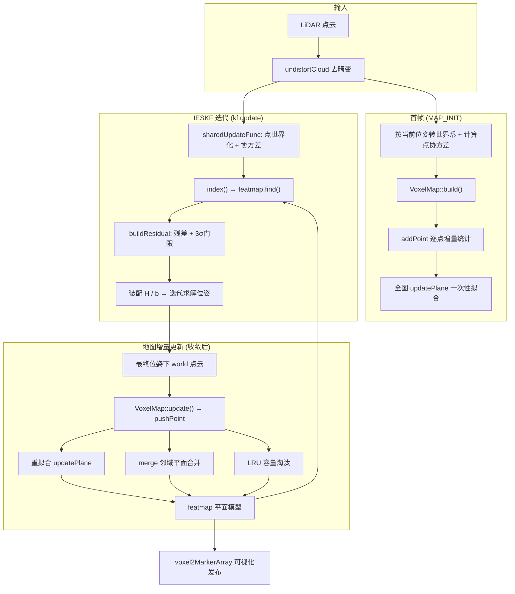

# VoxelMapPlus 体素地图模块说明文档

> 源文件：`voxel_plus/src/map_builder/voxel_map.cpp` / `voxel_map.h`
> 关联模块：`lio_builder.cpp`（调用方）、`ieskf.cpp`（优化器）、`utils.cpp`（可视化）、`lio_node.cpp`（参数配置）

---

## 1. 模块定位与核心思想

本模块是 FAST-LIO2 风格激光惯性里程计中的**局部地图（Local Map）**，负责：

1. **存储**：把世界坐标系下、带协方差的点云按固定边长体素离散化；
2. **压缩**：每个体素用**一个平面模型 + 不确定性**代替原始点云，天然去冗余、抗噪声；
3. **供观测**：对 IESKF 迭代中的每一个雷达点，O(1) 地查出所在体素的平面，生成"点到面"残差及其协方差；
4. **管理**：通过 LRU 缓存 + 邻域平面合并，把地图规模和特征数控制在实时可用的量级。

一句话概括：**地图里不存点，只存平面；平面带协方差，协方差参与优化加权。**

体素的生命周期由"点累积 → 平面拟合 → 冻结 → 合并共享"四步组成，见第 3.7 节状态机。

---

## 2. 数据结构一览

### 2.1 `VoxelKey`（[voxel_map.h:17-34](../src/map_builder/voxel_map.h#L17-L34)）

整数体素坐标 `(x, y, z)` + 自定义哈希：

```cpp
((((z * HASH_P) % MAX_N + y) * HASH_P) % MAX_N + x)   // HASH_P = 116101
```

配合 `std::unordered_map` 构成 `Featmap`（[voxel_map.h:105](../src/map_builder/voxel_map.h#L105)），实现体素的 O(1) 增删查。

### 2.2 `PointWithCov`（[voxel_map.h:36-41](../src/map_builder/voxel_map.h#L36-L41)）

```
world 系点坐标 point (3x1) + 该点的 3x3 协方差 cov
```

协方差由 `lio_builder` 计算：雷达测距/测角噪声模型经外参旋转传播 + 当前位姿不确定性（`hat(p_body)·P_R·hat(p_body)ᵀ + P_p`），见 [lio_builder.cpp:235-237](../src/map_builder/lio_builder.cpp#L235-L237)。

### 2.3 `Plane`（[voxel_map.h:43-51](../src/map_builder/voxel_map.h#L43-L51)）

| 成员 | 含义 |
|------|------|
| `mean` | 体素内点云质心（平面中心） |
| `ppt` | 二阶矩 Σ p·pᵀ（配合 mean、n 可随时还原协方差） |
| `norm` | 平面法向量（单位向量，符号约定指向使 `-mean·norm > 0` 的一侧） |
| `cov` | **6x6 平面参数协方差**，块顺序 `[norm(3); mean(3)]` |
| `n` | 已纳入统计的点数 |

### 2.4 `ResidualData`（[voxel_map.h:53-65](../src/map_builder/voxel_map.h#L53-L65)）

点到面残差的输入/输出载体：输入 `point_world`、`cov_lidar/cov_world`；输出 `plane_norm`、`plane_mean`、`plane_cov`、`residual`、`is_valid`。由 `lio_builder::sharedUpdateFunc` 每点一份、并行填充。

### 2.5 `VoxelGrid`（[voxel_map.h:69-103](../src/map_builder/voxel_map.h#L69-L103)）

单个体素，核心状态标志：

- `is_init`：是否完成过一次平面拟合（一旦 true 不再复位）；
- `is_plane`：当前拟合结果是否为有效平面（每次重拟合可翻转）；
- `update_enable`：是否还接受新点（点数达到 `max_point_thresh` 后关闭，体素"冻结"）；
- `newly_add_point`：距上次重拟合累计的新点数；
- `group_id` / `merged`：合并组的统一编号 / 是否发生过合并（可视化时区分圆柱/立方体标记）；
- `temp_points`：参与拟合的滑窗点（冻结时释放内存）；
- `merge_thresh_for_angle / merge_thresh_for_distance`：**静态**合并阈值，由 [lio_builder.cpp:24-25](../src/map_builder/lio_builder.cpp#L24-L25) 在启动时统一注入。

### 2.6 `VoxelMap`（[voxel_map.h:107-131](../src/map_builder/voxel_map.h#L107-L131)）

| 成员 | 作用 |
|------|------|
| `featmap` | `unordered_map<VoxelKey, shared_ptr<VoxelGrid>>`，全部体素 |
| `cache` | `std::list<VoxelKey>`，**LRU 链表**（头部最新） |
| `capacity` | 体素上限，超出从 `cache` 尾部淘汰 |
| `voxel_size` | 体素边长（米） |
| `max_point_thresh` | 单体素最大采样点数（达阈值即冻结） |
| `update_point_thresh` | 触发一次重拟合所需的新点数 |
| `plane_thresh` | 平面判定阈值（最小特征值上限） |
| `max_residual` | 残差门限的**绝对下限**（米），见 3.4 |

---

## 3. 原理与关键算法

### 3.1 体素索引 `index()`（[voxel_map.cpp:194-198](../src/map_builder/voxel_map.cpp#L194-L198)）

```cpp
Eigen::Vector3d idx = (point / voxel_size).array().floor();
```

`floor` 对负坐标同样正确取整，因此原点两侧坐标不会因截断混入同一体素。查询复杂度 O(1)。

### 3.2 平面拟合 `updatePlane()`（[voxel_map.cpp:97-136](../src/map_builder/voxel_map.cpp#L97-L136)）

采用**增量统计 + 批量 PCA**：

1. 逐点增量维护（`addToPlane`，[第29-34行](../src/map_builder/voxel_map.cpp#L29-L34)）：
   - 均值：`mean += (p - mean) / (n+1)`（在线平均，无需存全部点）；
   - 二阶矩：`ppt += p·pᵀ`。
2. 拟合时还原协方差并做对称特征分解：
   ```cpp
   cov = ppt / n - mean·meanᵀ;
   SelfAdjointEigenSolver → 特征值 evals 升序, 特征向量 evecs
   ```
3. **平面判据**：最小特征值 `evals(0) > plane_thresh` → 点云在该体素内三维弥散，判为**非平面**（`is_plane = false`），该体素不参与后续残差构建；否则是平面，法向量取最小特征值对应的特征向量 `evecs.col(0)`。
4. 法向符号统一：令 `-mean·norm > 0`（法向指向坐标原点一侧，消除 ±n 的符号二义性）。
5. 记录 `center = mean` 供可视化。

> 重拟合触发频率由 `update_point_thresh` 控制：每新进 N 个点才重算一次 PCA，把 O(n) 的拟合开销摊薄；期间残差仍用旧平面。

### 3.3 平面不确定性传播（[voxel_map.cpp:113-130](../src/map_builder/voxel_map.cpp#L113-L130)）

拟合时不只求法向量，还要把每个点的噪声协方差传播到平面参数上，得到 `[norm; mean]` 的 6x6 协方差：

```
J = [ evecs·F   ]   // 3x3，法向量对点的雅可比（特征扰动一阶展开）
    [   I / n   ]   // 3x3，均值协方差 = 点协方差 / n
plane->cov += J · Σ_point · Jᵀ
```

其中 `F.m = (p-mean)ᵀ / (n·(λ0-λm)) · (e_m·n₀ᵀ + n₀·e_mᵀ)`。

这个 6x6 协方差随后在残差构建中投影为标量方差，**决定该平面观测在 IESKF 中的权重**：拟合质量差的平面（点数少、点噪声大）残差方差大，对位姿的牵引自然变弱。

### 3.4 点到面残差与门限 `buildResidual()`（[voxel_map.cpp:258-277](../src/map_builder/voxel_map.cpp#L258-L277)）

对每个雷达点、其所在体素的平面：

```
r = n·(p_world - mean)                       // 点到面距离
J_nq = [ (p_world - mean)ᵀ , -nᵀ ]           // 对 [norm; mean] 的雅可比
σ_l  = J_nq · Σ_plane · J_nqᵀ + nᵀ · Σ_world · n
gate = max(3·√σ_l , max_residual)
|r| < gate  → is_valid = true，该点进入优化
```

- **3σ 卡方门限**：剔除动态物体、错误关联等外点；
- **绝对下限 `max_residual`（默认 0.5 m）**：头文件注释解释了动机——无逐点去畸变、叠加体素量化误差时，纯 3σ 门限过紧：位姿一旦滞后，所有能反映误差的点会被全部剔除，状态"卡死"无法回拉。给门限一个下限可保证始终有有效观测。

### 3.5 体素合并 `merge()`（[voxel_map.cpp:138-186](../src/map_builder/voxel_map.cpp#L138-L186)）

**触发条件**：平面体素冻结（`update_enable == false`）后，每再收到一个点尝试一次合并。

**合并对象筛选**（6 邻域逐个体素检查，[第140-155行](../src/map_builder/voxel_map.cpp#L140-L155)）——必须同时满足：

| 条件 | 说明 |
|------|------|
| `group_id` 不同 | 不与已同组的重复合并 |
| `update_enable == false` | 对方也已冻结（正在累积的体素不参与） |
| `is_plane == true` | 对方是有效平面 |
| `1 - n₀·n₁ < merge_thresh_for_angle` | 两平面法向夹角足够小 |
| `\|n₀·mean₀ - n₁·mean₁\| < merge_thresh_for_distance` | 两平面截距（沿法向的偏移）足够近 |

**融合公式**（[第161-179行](../src/map_builder/voxel_map.cpp#L161-L179)）：以各自协方差的迹（`tn`=法向块迹，`tm`=均值块迹）作为不确定度权重做加权平均——

```
new_mean = (tm₀·mean₁ + tm₁·mean₀) / (tm₀ + tm₁)
new_norm = (tn₀·norm₁ + tn₁·norm₀) / (tn₀ + tn₁)
new_cov  = (tc₀²·cov₁ + tc₁²·cov₀) / (tc₀ + tc₁)²     // tc = tn + tm
```

不确定性大的一方被"稀释"，两个体素共享同一套平面参数，并统一 `group_id`。

> **关键设计**：合并是**平面参数同步**，不搬运点云。相邻共面体素收敛到同一个平面模型，等价于把一个大平面从"每体素一份特征"压缩为一条共享特征，同时保持 O(1) 的空间索引结构不变。合并过的体素在可视化中画成立方体（`merged` 标志，[utils.cpp:383-386](../src/utils.cpp#L383-L386)）。

### 3.6 容量管理：LRU 缓存（[第209-221行](../src/map_builder/voxel_map.cpp#L209-L221)、[第243-253行](../src/map_builder/voxel_map.cpp#L243-L253)）

- 新体素：`cache.push_front(k)` 并记录迭代器 `cache_it`；
- 命中已有体素：`cache.splice(cache.begin(), cache, it)` 提到头部；
- 超容量：`featmap.erase(cache.back()); cache.pop_back()` 淘汰最久未写入的体素。

保证长期运行的建图内存有界（`map_capacity` 个体素 × 常数开销）。注意：淘汰只在**写入路径**发生；残差查询只读不更新热度。

### 3.7 体素状态机 `pushPoint()`（[voxel_map.cpp:42-95](../src/map_builder/voxel_map.cpp#L42-L95)）

```
                新点到达
                   │
        ┌──────────▼──────────┐
        │  !is_init ?         │
        └──┬───────────────┬──┘
           │是             │否
           │               │
   累加 + 立即重拟合   ┌───▼────────────┐
   (点数<阈值时拟合    │ update_enable? │
    早退, 仅累积)      └──┬────────┬────┘
                     是   │        │  否
                          │        │
                累加/计数 │        │ is_plane ?
                每 +N 点重拟合      │
                满 max 点 → 冻结 ┌──┴───┐
                (释放 temp_points)  是   否
                          │     │       │
                          │  merge()   (保持冻结,
                          │   尝试合并   不再变化)
                          └─────┘
```

三个阶段的行为特征：

| 阶段 | 行为 | 复杂度 |
|------|------|--------|
| 初始化（`!is_init`） | 每点累加并尝试拟合（未达 `update_point_thresh` 时拟合早退） | O(1)/点 |
| 活跃（`update_enable`） | 每点 O(1) 增量统计；每 N 点一次 O(\|temp_points\|) 重拟合 | 摊薄 O(1)/点 |
| 冻结（`!update_enable`） | 平面体素每点尝试与 6 邻居合并；非平面体素不再变化 | 每点 6 次哈希查询 |

---

## 4. 数据流

### 4.1 全链路总览



### 4.2 建图阶段 `build()`（[voxel_map.cpp:200-230](../src/map_builder/voxel_map.cpp#L200-L230)）

- 调用点：[lio_builder.cpp:242](../src/map_builder/lio_builder.cpp#L242)，仅在状态机 `MAP_INIT → LIO_MAPPING` 的那一帧执行一次；
- 流程：逐点 `index → 建/找体素 → addPoint`（只做增量统计），最后**遍历全部体素**执行一遍 `updatePlane()` 完成首轮拟合；
- 特点：不触发合并、不做门限（还没有地图可供残差）。

### 4.3 增量更新 `update()`（[voxel_map.cpp:232-256](../src/map_builder/voxel_map.cpp#L232-L256)）

- 调用点：[lio_builder.cpp:296](../src/map_builder/lio_builder.cpp#L296)，在 `kf.update()` **收敛之后**，用最终位姿把当前帧点云转入世界系再入图（避免把未收敛的错位点写进地图）；
- 流程：逐点 `pushPoint`（状态机逻辑：增量统计 / 重拟合 / 合并 / LRU）；
- 与 `build()` 的唯一结构差异：用 `pushPoint` 代替 `addPoint`，即启用冻结—合并机制。

### 4.4 优化中的观测消费（[lio_builder.cpp:300-324](../src/map_builder/lio_builder.cpp#L300-L324)）

`sharedUpdateFunc` 在 IESKF 的每次迭代中并行执行：

1. 点由雷达体系转到世界系，并按当前状态协方差重算 `cov_world`；
2. `map->index(point_world)` 定位体素 → `featmap.find()` 查平面；
3. `buildResidual()` 生成残差与有效性标志；
4. 串行装配 `H`、`b`（[lio_builder.cpp:326-350](../src/map_builder/lio_builder.cpp#L326-L350)），其中观测权重 `r_info = 1 / r_cov`（`r_cov < 2e-4` 时封顶 5000），随后求解增量。

要点：
- **观测的方向**：残差梯度对位姿的雅可比为 `nᵀ`（平移）与 `-nᵀ·R·hat(R_ext·p_l + p_ext)`（旋转与外参），即平面法向是唯一的约束方向；
- 体素不是平面（`is_plane=false`）或查找失败的点直接跳过，贡献 0 残差；
- 未建图前的点（首帧）不参与残差。

### 4.5 可视化发布（[lio_node.cpp:309](../src/lio_node.cpp#L309)、[utils.cpp:351-404](../src/utils.cpp#L351-L404)）

`publish_voxel_map=true` 时把 LRU 链表头部的至多 `publish_voxel_num` 个体素画成 Marker：

- 跳过非平面与仍在更新的体素；
- 颜色按法向块协方差迹映射 jet 色表（迹越大越"不确定"，上限截断 0.25）；
- 未合并 → 圆柱（CYLINDER），已合并 → 立方体（CUBE），朝向对齐平面法向，厚度 0.01。

---

## 5. 参数配置

参数经 `lio_node.cpp` 从 ROS 参数服务器读取，构造 `LIOBuilder` 时传入（[lio_builder.cpp:21-25](../src/map_builder/lio_builder.cpp#L21-L25)）：

| 参数 | 含义 | 代码默认 | [mapping.yaml](../config/mapping.yaml#L28-L35)（KITTI） |
|------|------|----------|----------------------|
| `voxel_size` | 体素边长（米） | 0.4 | 0.4 |
| `map_capacity` | 体素容量上限 | 100000（`VoxelMap` 构造默认 2000000） | 300000 |
| `max_point_thresh` | 单体素最大采样点数 | 100 | 100 |
| `update_size_thresh` | 重拟合所需新点数 | 10 | 20 |
| `plane_thresh` | 平面判据（最小特征值上限） | 0.01（[lio_builder.h:47](../src/map_builder/lio_builder.h#L47)） | — |
| `merge_thresh_for_angle` | 合并法向角差阈值 `1-cosθ` | 0.1 | 0.2 |
| `merge_thresh_for_distance` | 合并平面截距差阈值（米） | 0.04 | 0.04 |
| `max_residual` | 残差门限绝对下限（米） | 0.5 | 0.5 |

调参提示：

- `voxel_size` 与 `plane_thresh` 需配合：体素越大，体素内可用点数越多但平面假设越易被破坏（弯曲墙面、地面与台阶混入同一体素）；阈值越紧，判为平面的体素越少、约束越干净。
- `update_size_thresh` 越大，重拟合越省算力但平面"陈旧"时间越长。
- `merge_thresh_for_angle` 为 `1-cosθ`（非弧度）：0.1 ≈ 25.8°，0.2 ≈ 36.9°，实际语义是"多平缓的两个面才允许合并"，长走廊、缓坡场景可适当放宽。

---

## 6. 与 IESKF 的耦合关系

- **输入侧**（体素地图 → 优化器）：平面法向、平面中心、6x6 平面协方差、有效性标志；
- **输出侧**（优化器 → 体素地图）：收敛后的位姿把新点云写入地图，同时点协方差携带位姿不确定性；
- **闭合回路**：位姿误差 → 世界系点位置偏差 → 残差变大 → 但若超过门限会被 3σ + `max_residual` 下限保护，保留部分有效观测把状态拉回（这正是 `max_residual` 作为"防卡死下限"存在的原因）。

---

## 7. 实现细节观察与潜在问题

以下为阅读代码时的观察，供后续排查/优化参考（非确定性结论）：

1. **`plane->cov` 的清零问题**（[voxel_map.cpp:129](../src/map_builder/voxel_map.cpp#L129)）：
   - `Plane` 结构体中 `Eigen::Matrix<double, 6, 6> cov;` 未显式零初始化（[voxel_map.h:49](../src/map_builder/voxel_map.h#L49)），Eigen 定长矩阵默认构造不写内存；
   - `updatePlane()` 里做的是 `cov += ...` 累加，且每次重拟合都会把 `temp_points` 中的**全部旧点**再累加一遍，等价于旧点的噪声贡献被重复计入、随重拟合次数增长。
   - 若设计意图是"当前全部点噪声的一次传播"，应在累加前 `plane->cov.setZero()`。
2. **冻结后的合并重试**（[voxel_map.cpp:72](../src/map_builder/voxel_map.cpp#L72)）：`update_enable=false` 后，每个新点都会触发一次 `merge()`，会产生持续的加权平均拉力（邻域平面被反复向本平面方向修正）。若这是有意为之，可视为"缓慢对齐"；若非，可加一个"合并一次后置位/限频"的开关。
3. **非平面体素冻结后成为死重量**：`is_plane=false` 且冻结的体素不再更新也不参与残差，只占内存，直到被 LRU 淘汰。
4. **LRU 热度只在写入路径更新**：纯查询（残差计算）不刷新热度；视觉上"最常用"与内存上"最久未写"是两套含义。
5. **`build()` 末段全图重拟合**：O(全图体素数)，仅首帧调用一次可忽略；若未来支持多次重建图需注意复杂度。
6. **`VoxelGrid::count` 单调自增**：仅用作 `group_id` 分配，长期运行不受 32 位溢出影响（`uint64_t`）。

---

## 8. 接口速查

| 接口 | 位置 | 说明 |
|------|------|------|
| `VoxelMap(max_point_thresh, update_point_thresh, plane_thresh, voxel_size, capacity)` | [voxel_map.cpp:188](../src/map_builder/voxel_map.cpp#L188) | 构造，默认容量 2,000,000 |
| `VoxelKey index(point)` | [voxel_map.cpp:194](../src/map_builder/voxel_map.cpp#L194) | 世界点 → 体素键 |
| `void build(pvs)` | [voxel_map.cpp:200](../src/map_builder/voxel_map.cpp#L200) | 首帧建图（含全图拟合） |
| `void update(pvs)` | [voxel_map.cpp:232](../src/map_builder/voxel_map.cpp#L232) | 增量更新（状态机 + 合并 + LRU） |
| `bool buildResidual(data, voxel_grid)` | [voxel_map.cpp:258](../src/map_builder/voxel_map.cpp#L258) | 点到面残差 + 门限判定 |
| `VoxelGrid::updatePlane()` | [voxel_map.cpp:97](../src/map_builder/voxel_map.cpp#L97) | PCA 平面拟合 + 协方差传播 |
| `VoxelGrid::merge()` | [voxel_map.cpp:138](../src/map_builder/voxel_map.cpp#L138) | 6 邻域共面合并 |
| `voxel2MarkerArray(...)` | [utils.cpp:351](../src/utils.cpp#L351) | 体素平面可视化 |
